<a id="top"></a>
<a id="-doctor-dev"></a>

<div align="center">


<br>

<a href="https://github.com/priyanshusharan-cmd/doctor-dev">
  
</a>

<br><br>

[](https://www.typescriptlang.org/)
[](https://react.dev/)
[](https://expressjs.com/)
[](https://vite.dev/)
[](https://nodejs.org/)
[](#-quality-and-validation)
[](#-built-with-ibm-bob-20)
[](LICENSE)

**A repository health scanner that finds missing test coverage, configuration drift, unsafe runtime assumptions, and release risks — before they become expensive failures.**

Built for the **IBM Bob 2.0 Hackathon** · Powered by real repository evidence · Designed for actionable results

<kbd>[🎬 Demo](#-demo-video)</kbd>&nbsp;
<kbd>[📸 Tour](#-product-tour)</kbd>&nbsp;
<kbd>[🏗️ Architecture](#-architecture)</kbd>&nbsp;
<kbd>[⚡ Quick start](#-quick-start)</kbd>&nbsp;
<kbd>[🔐 Security](#-security-model)</kbd>&nbsp;
<kbd>[🤖 IBM Bob](#ibm-bob-usage-evidence)</kbd>&nbsp;
<kbd>[🎤 Deck](#-hackathon-presentation)</kbd>

</div>


> [!NOTE]
> Doctor Dev does not return a vague AI review. It scans real files, builds structured evidence, assigns confidence, prioritizes risks, and produces concrete recommendations that a developer can act on.

## 🎬 Demo video

<div align="center">

https://github.com/user-attachments/assets/0f762bcb-6212-45c9-b160-565cfe1926e8

</div>


## ✨ The idea in one minute

Modern repositories rarely fail because of one obvious syntax error. They fail **in the gaps between systems**:

<table>
<tr>
<td width="50%" valign="top">

🧪 **Testing gaps**
- a critical function exists, but no test proves its behavior
- a public API route has happy-path tests but no authorization test

</td>
<td width="50%" valign="top">

⚙️ **Configuration drift**
- code reads `JWT_SECRET`, but onboarding docs never mention it
- Docker exposes one port while the application binds to another
- CI uses a Node version that conflicts with `package.json`
- the README documents a command that no longer exists

</td>
</tr>
</table>

Each file can look correct while the repository as a whole is inconsistent. **Doctor Dev connects those signals:**

<div align="center">
</div>

Point it at a local directory or a public GitHub repository and it produces:

| | Output | |
|:-:|---|---|
| 1 | 🧬 **Technology profile** | language, framework, package manager, test runner, monorepo layout |
| 2 | 🧪 **Test health** | evidence-based mapping of tests to the code they cover |
| 3 | ⚙️ **Config consistency** | env vars, Docker, Compose, CI, ports, runtime, README |
| 4 | 🚨 **Prioritized findings** | severity *and* confidence, with the evidence behind each |
| 5 | 📊 **Health score** | testing, configuration, and security scores, graded **A → F** |
| 6 | 🧩 **Test skeletons** | starter tests for the highest-impact gaps, with correct imports |
| 7 | 📋 **Reports** | downloadable Markdown and JSON |


## 📸 Product tour

Select a view to expand it, then select the image to open it at full resolution.

<div align="center">

</div>

<details>
<summary><strong>📸 01 · Landing and repository input</strong></summary>
<br>

[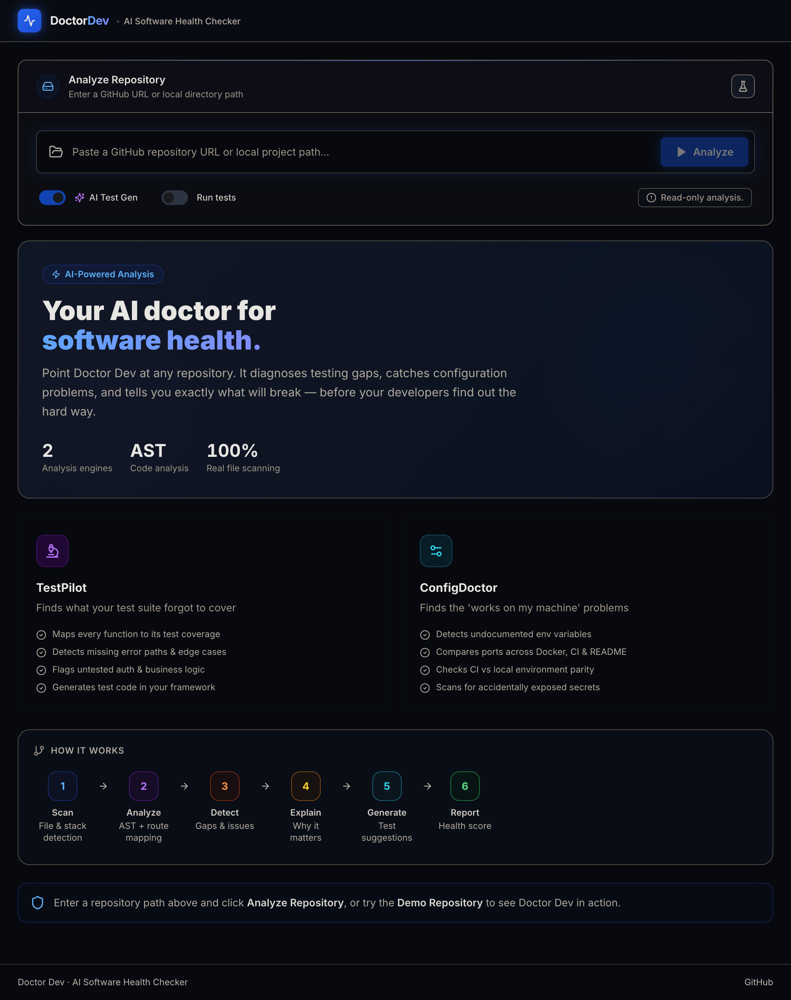](submission/screenshots/01-landing-and-repository-input.png)

</details>

<details>
<summary><strong>📊 02 · Repository profile and health overview</strong></summary>
<br>

[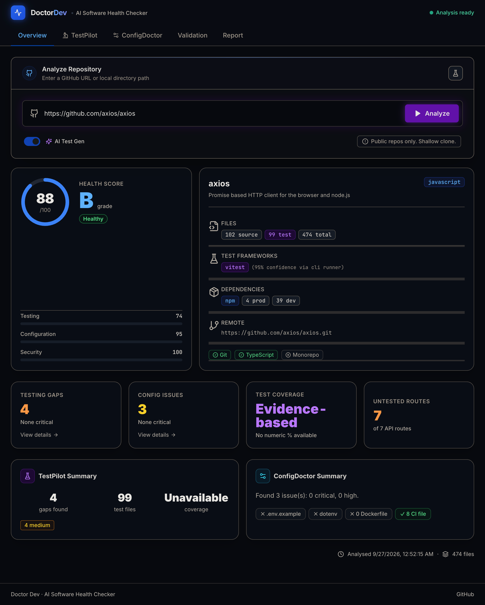](submission/screenshots/02-health-overview.png)

</details>

<details>
<summary><strong>🧪 03 · TestPilot evidence and testing gaps</strong></summary>
<br>

[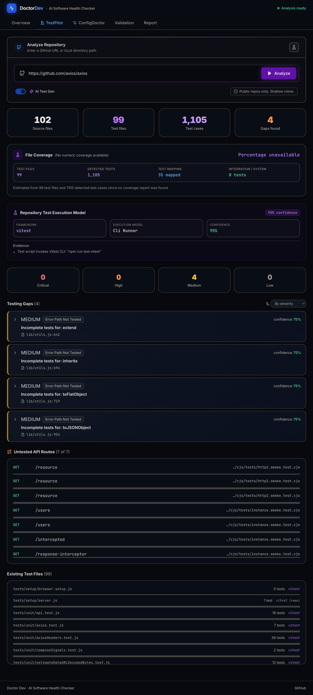](submission/screenshots/03-testpilot-evidence.png)

</details>

<details>
<summary><strong>⚙️ 04 · ConfigDoctor findings</strong></summary>
<br>

[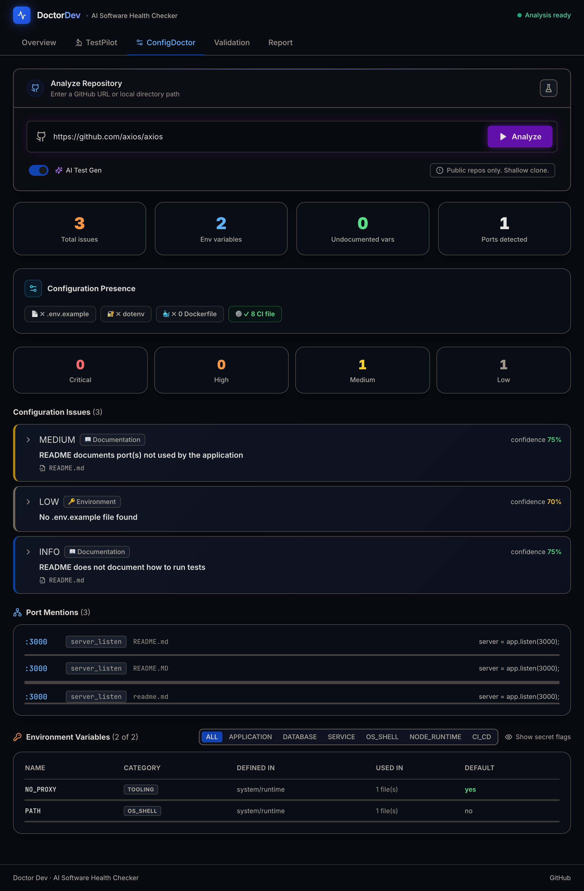](submission/screenshots/04-configdoctor-findings.png)

</details>

<details>
<summary><strong>📋 05 · Final health report and export actions</strong></summary>
<br>

[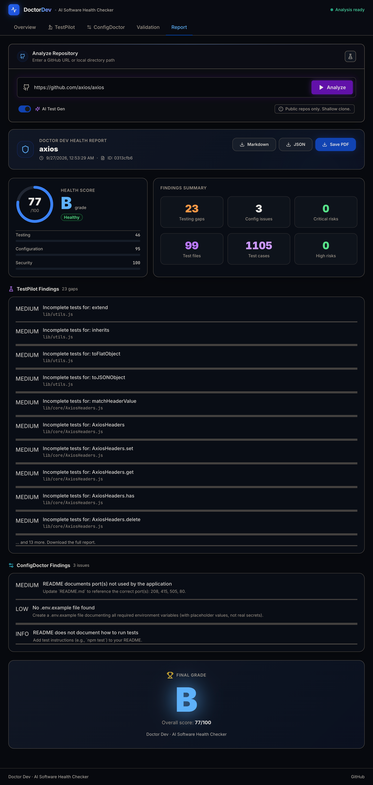](submission/screenshots/05-final-health-report.png)

</details>


## 🎯 The problem

Developers lose time to repository-wide inconsistencies that ordinary tools inspect in isolation. Linters validate syntax. Test runners execute the tests that already exist. CI runs whatever it was configured to run. Documentation drifts away from code.

| Question | Why existing tools miss it |
|---|---|
| Which important behaviors have no meaningful test evidence? | A passing suite says nothing about code that was never exercised. |
| Are environment variables used in code actually documented? | Code, templates, Docker, and docs are usually checked separately. |
| Do runtime, Docker, CI, and documentation agree? | Each source can be valid by itself and contradictory as a system. |
| What should the team fix first? | Raw warnings do not explain impact, confidence, or priority. |
| Can a new contributor run the project successfully? | Onboarding failures emerge only after someone follows stale instructions. |

Doctor Dev treats the **repository as a connected system**, not a bag of unrelated files.

## 💡 The solution — two diagnostic engines

<table>
<tr>
<td width="50%" valign="top">

### 🧪 TestPilot

*Finds important behavior that lacks sufficient test evidence.*

- Maps test files to production files by name, import, and path
- Extracts symbols and API routes with a real AST (`ts-morph`)
- Ranks code by importance — auth, payments, data, routes
- Detects missing happy, error, edge-case, and auth paths
- Separates production code from fixtures, examples, and benchmarks
- Labels heuristic results honestly
- Generates starter tests (Jest, Vitest, Mocha, `node:test`, pytest)

</td>
<td width="50%" valign="top">

### ⚙️ ConfigDoctor

*Finds drift across code, config, containers, CI, runtime, and docs.*

- Compares env-var usage (`process.env`, `import.meta.env`, `os.environ`) with templates — including per-package `.env.example` files
- Checks Docker for deterministic installs, exposed ports, and non-root users
- Detects inconsistent port declarations
- Reviews CI install, test, and Node-version setup (matrix and `.nvmrc` aware)
- Verifies README setup guidance
- Flags secrets **by name only** — values are never read into output
- Recommends a specific fix for every issue

</td>
</tr>
</table>

Together they answer one practical question: **what is most likely to break, why does Doctor Dev believe that, and what should the developer do next?**


## 🏗️ Architecture

<div align="center">
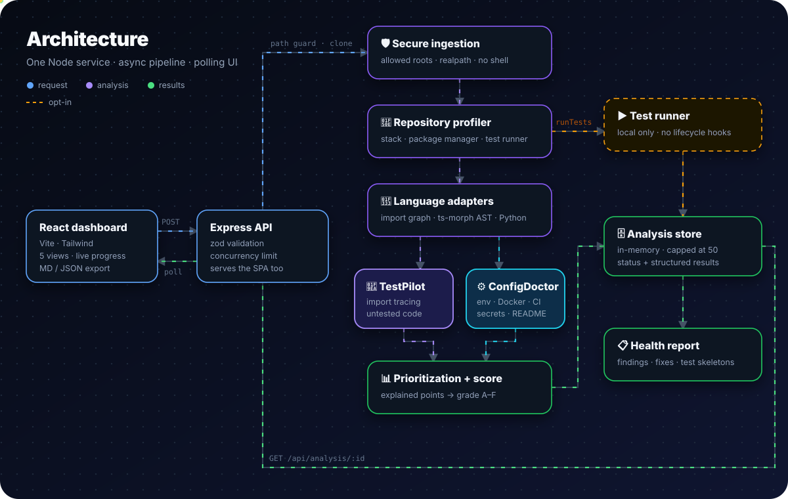
</div>

<br>

<div align="center">
</div>

| Stage | What happens |
|---|---|
| 🛡️ **Secure ingestion** | Validates an allowed local path, or shallow-clones a public GitHub repository without a shell. An existing local folder always wins over the `owner/repo` short form. |
| 📂 **Repository scan** | Finds and classifies source, test, config, fixture, example, and benchmark files. |
| 🌳 **Code analysis** | Extracts symbols, routes, importance signals, and source classifications. |
| 🧪 **Test analysis** | Detects runners, counts tests, maps evidence, and reads supported coverage artifacts. |
| ⚙️ **Config analysis** | Cross-checks variables, ports, containers, CI, docs, and runtime metadata. |
| 📊 **Prioritization** | Converts gaps and issues into ranked findings and component scores. |
| 📋 **Reporting** | Stores structured results for the dashboard and exports. |

<details>
<summary><strong>🧭 Text version (Mermaid)</strong></summary>
<br>

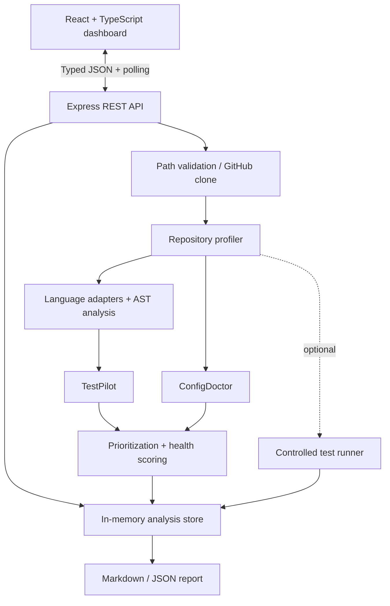

</details>

<details>
<summary><strong>🗂️ Code layout</strong></summary>
<br>

```text
backend/src/
├── routes/          Express route definitions
├── controllers/     Validation, rate limits, HTTP orchestration
├── services/        Pipeline, GitHub ingestion, prioritization
├── analyzers/
│   ├── languages/   JavaScript/TypeScript and Python adapters
│   ├── repositoryAnalyzer.ts
│   ├── codeAnalyzer.ts
│   ├── configAnalyzer.ts
│   ├── testPilot.ts
│   └── configDoctor.ts
├── runners/         Controlled test execution
├── models/          In-memory analysis store
├── types/           Shared domain model
└── utils/           Security and filesystem helpers

frontend/src/
├── api/             Typed REST client
├── components/      Cards, navigation, progress, and inputs
├── pages/           Overview, Testing, Configuration, Validation, Report
├── lib/             Pure presentation helpers
└── types/           Frontend result types
```

</details>


## 🚀 What Doctor Dev finds

<details open>
<summary><strong>🧬 Repository understanding</strong></summary>

- Detects language, ecosystem, framework, package manager, test runner, entry points, and monorepo structure.
- Recognizes npm, yarn, pnpm, Bun, pip, Poetry, Maven, Gradle, Cargo, Go modules, Bundler, and Composer metadata.
- Separates source, test, fixture, helper, benchmark, example, generated, and build files.
- Reads package scripts, dependency evidence, config files, Git metadata (with credentials stripped), and coverage artifacts.

</details>

<details>
<summary><strong>🧪 Evidence-based testing analysis</strong></summary>

- JavaScript/TypeScript structural analysis with `ts-morph`.
- Python symbol, route, and `def test_*` discovery through a language adapter.
- Importance scoring for exported functions, services, controllers, middleware, and route handlers.
- Test-to-source mapping using names, imports, and path proximity — generic names like `index.ts` need a shared folder to count.
- Route detection that ignores HTTP-client calls (`axios.get('/users')`) and `app.use()` mounts.
- Gap categories for absent, partial, error, edge-case, and authorization tests.
- A confidence score and human-readable evidence on every meaningful finding.

</details>

<details>
<summary><strong>📏 Honest coverage states</strong></summary>

Doctor Dev never presents a made-up percentage:

| State | Meaning |
|---|---|
| **Actual Coverage** | Parsed from a supported artifact such as LCOV or `coverage-summary.json`. |
| **Evidence Based** | Inferred from imports, naming, paths, and detected test cases. Explicitly labeled heuristic. |
| **Unavailable** | Not enough trustworthy evidence to claim coverage. |

A coverage report whose percentage can't be parsed is scored on test evidence — never on an assumed number.

</details>

<details>
<summary><strong>⚙️ Configuration diagnosis</strong></summary>

- Compares code-level environment-variable usage with templates across the whole repository.
- Filters tooling, CI, OS, and runtime variables (and Vite built-ins) to reduce false positives.
- Reviews Dockerfiles for deterministic installs, exposed ports, and non-root execution.
- Compares Docker Compose variables with required secrets, honoring `env_file:`.
- Reviews CI configuration for runtime version, installation, and test steps.
- Finds README omissions, stale commands, and documented port conflicts.
- Only asks for a `package.json` test script in projects that actually have a `package.json`.

</details>

<details>
<summary><strong>📊 Prioritization and reporting</strong></summary>

- Produces testing, configuration, security, and overall scores.
- Assigns grades from **A** to **F** and a state of healthy, needs attention, or critical.
- Groups related issues into a focused priority list with evidence, reasoning, a recommended action, and estimated impact.
- Exports results as Markdown or structured JSON.

</details>


## ⚡ Quick start

> **Prerequisites:** Node.js 18+ · npm 9+ · Git (for GitHub repository analysis)

```bash
git clone https://github.com/priyanshusharan-cmd/doctor-dev.git
cd doctor-dev
npm run install:all
cp backend/.env.example backend/.env
npm run dev
```

| Service | URL |
|---|---|
| 🖥️ Frontend | `http://localhost:5173` |
| 🔌 Backend | `http://localhost:3001` |
| 💓 Health | `http://localhost:3001/api/health` |

Then paste a public GitHub URL, enter an allowed local path, or choose **Try Demo**.

<details>
<summary><strong>🔧 Configuration options</strong></summary>
<br>

```dotenv
PORT=3001
FRONTEND_URL=http://localhost:5173

# Analyze local repositories outside the Doctor Dev folder and the system temp directory
DOCTOR_DEV_ALLOWED_ROOTS=/path/to/projects,/another/approved/root

# Maximum analyses running at once (default 3); extra requests get HTTP 429
DOCTOR_DEV_MAX_CONCURRENT=3
```

Equivalent manual installation:

```bash
npm install
npm install --prefix backend
npm install --prefix frontend
```

</details>

### 🧭 Workflow

1. **Choose a repository** — an approved local path, a full GitHub URL, or `owner/repository` shorthand.
2. **Choose options** — generate test suggestions, and optionally run a detected safe local test script.
3. **Watch the pipeline** — the UI reports each asynchronous stage live.
4. **Inspect evidence** — expand findings to see why they exist.
5. **Prioritize** — start with high-impact, high-confidence risks.
6. **Export** — download Markdown or JSON for review or planning.

### ☁️ Render deployment

Production runs as **one Node web service** serving both the dashboard and the API. Run `npm run build` from the repository root, then `NODE_ENV=production npm start`. The dashboard calls `/api` on the same origin, so `VITE_API_URL` is not needed. See the [Render deployment guide](docs/render-deployment.md); new deployments can use the included `render.yaml` Blueprint.


## 🎬 Demo scenario

The included [`demo-repository/`](demo-repository/) is a **deliberately imperfect** TypeScript rideshare API. It makes Doctor Dev's value visible in a short demo without hardcoding any results.

<table>
<tr>
<td width="50%" valign="top">

**🧪 Planted test risks**
- Ride cancellation lacks state-transition and auth cases
- Fare calculation lacks zero, negative, and boundary tests
- Peak-hour logic lacks weekend and off-peak coverage
- Payments lack idempotency and failure-path coverage
- Ride history lacks a meaningful authorization test

</td>
<td width="50%" valign="top">

**⚙️ Planted configuration risks**
- Docker and application ports disagree
- Docker Compose omits a required secret
- CI's Node version conflicts with `engines`
- CI does not run the test suite
- README has a stale port and command

</td>
</tr>
</table>

> [!IMPORTANT]
> These results are not injected into the product. Doctor Dev discovers them through the same pipeline it uses for every repository.

**Three-minute demo:** **Try Demo** → watch the stages → reveal the score and top finding → expand a TestPilot card → expand a ConfigDoctor card → open **Validation** for a generated test → download the Markdown report.


## 🔐 Security model

Doctor Dev analyzes repositories that may not be trustworthy, so safety is a product constraint.

<table>
<tr>
<td width="33%" valign="top">

### 🔑 Secrets
- Variable **names** may be reported; values never are.
- `API_KEY`, `SECRET`, `TOKEN`, `PASSWORD`, `PRIVATE_KEY`, `CREDENTIAL`, `AUTH`, `ACCESS_KEY` are flagged case-insensitively.
- Credentials embedded in git remotes (`https://user:token@…`) are stripped before display.
- Test runs do **not** inherit the server's environment.

</td>
<td width="33%" valign="top">

### 📁 Filesystem
- Paths are normalized, resolved through real paths, and checked against approved roots.
- Null bytes, traversal, symlink escapes, and non-directories are rejected.
- Another analysis's temporary GitHub clone can never be targeted.
- Analysis is read-only; file reads are size-capped.
- Error messages don't reveal server paths.

</td>
<td width="33%" valign="top">

### ⚙️ Processes
- Clones are shallow, time-limited, non-interactive, isolated, and deleted afterwards.
- Test execution is opt-in and local-only.
- Only recognized direct test-runner commands are accepted, and they run **directly** — `pretest`/`posttest` hooks never execute.
- Concurrent analyses are capped; stored results are bounded.

</td>
</tr>
</table>

> [!WARNING]
> Running a repository's tests still executes that repository's test code. Enable **Run tests** only for local repositories you trust. Static analysis remains read-only.


## 🔌 API reference

| Method | Endpoint | Description |
|---|---|---|
| `GET` | `/api/health` | Backend health and version |
| `POST` | `/api/analyze` | Start an asynchronous analysis (`202`, or `429` when busy) |
| `GET` | `/api/analysis/:analysisId` | Progress, error, or completed results |
| `GET` | `/api/analyses` | Analyses held by the current server process |

<details>
<summary><strong>Example: start and poll an analysis</strong></summary>
<br>

```bash
curl --request POST http://localhost:3001/api/analyze \
  --header 'Content-Type: application/json' \
  --data '{ "repositoryPath": "./demo-repository", "runTests": false, "generateTests": true }'
```

```json
{ "analysisId": "8ad32bb4-1fd5-4dc9-bfde-000000000000", "status": "pending" }
```

```bash
curl http://localhost:3001/api/analysis/8ad32bb4-1fd5-4dc9-bfde-000000000000
```

```json
{
  "id": "8ad32bb4-1fd5-4dc9-bfde-000000000000",
  "status": "analyzing_tests",
  "statusLabel": "Mapping test coverage",
  "repositoryPath": "/approved/path/to/repository",
  "createdAt": "2026-09-27T00:00:00.000Z"
}
```

Completed responses include the profile, symbols, routes, tests, mappings, gaps, generated tests, configuration health, priority findings, score, optional test-run result, and scan timestamp.

</details>


## 🧰 Technology stack

<div align="center">


</div>

| Area | Technology | Purpose |
|---|---|---|
| UI | React 18 + TypeScript | Strict component-based dashboard |
| Tooling | Vite 6 | Fast development and optimized builds |
| Styling | Tailwind CSS | Responsive utility-first design |
| Icons · Charts | Lucide React · Recharts | Visual language and health visualization |
| API | Express + TypeScript | Typed analysis endpoints |
| Validation | Zod 4 | Runtime request validation |
| AST | ts-morph | Structural JavaScript/TypeScript analysis |
| Discovery | fast-glob | Repository file classification |
| Processes | execa | Argument-based Git and controlled test execution |
| Development | IBM Bob 2.0 | Architecture, implementation, review, debugging |

## ⌨️ Commands

| Command | Purpose |
|---|---|
| `npm run dev` | Start backend and frontend together |
| `npm run build` | Compile the backend and build the frontend |
| `npm run typecheck` | Strict TypeScript checks |
| `npm test` | API tests, regression tests, and analyzer benchmarks |
| `npm run lint` | Configured package lint checks |
| `npm run install:all` | Install all workspace dependencies |

## 🧪 Quality and validation

**42 automated checks** run on `npm test`:

- **API tests** (vitest) — SPA serving, JSON errors, malformed bodies, dotfile protection, same-origin API.
- **Regression tests** (vitest) — GitHub URL parsing, clone-name recovery, credential stripping, clone isolation, Jest/Vitest/Mocha/TAP result parsing, route-detection false positives, Python class scope, generated-test imports, ConfigDoctor false positives, and priority wording.
- **Analyzer benchmarks** — ecosystem classification, env-var semantics, port filtering, Python discovery, score calibration, coverage states, framework propagation, package-manager detection, large-repository false-positive prevention, traversal protection, and test-command injection.

```bash
npm test && npm run typecheck && npm run build
```

Engineering principles: strict TypeScript · structured JSON, not prose · evidence on every non-trivial finding · no hardcoded demo results · read-only analysis · honest confidence labels · a runnable app at every phase gate.


## 🎤 Hackathon presentation

The eight-slide deck covers the developer-workflow problem, the two analysis engines, the evidence-based pipeline, the product experience, business value, IBM Bob usage, and the roadmap.

<div align="center">

### [⬇️ Download the Doctor Dev presentation deck](submission/Doctor_Dev_Hackathon_Presentation_Deck.pptx)

**Microsoft PowerPoint · 8 slides · Includes presenter notes**<br>
[View the final PDF](submission/Doctor_Dev_Hackathon_Deck_Final.pdf)

</div>


## 🤖 Built with IBM Bob 2.0

Doctor Dev was developed with **IBM Bob 2.0 as a senior pair-programming partner**, directly supporting the developer workflow that the product improves.

IBM Bob contributed to the TestPilot and ConfigDoctor architecture; backend boundaries and the shared type model; repository discovery and AST analysis; evidence-based test mapping and health scoring; mature-repository false-positive debugging; the React dashboard and complete UI states; path, secret, Git, and test-execution security; the demo scenario and technical documentation; and strict TypeScript and regression review.

The detailed development narrative is in [`docs/bob-usage.md`](docs/bob-usage.md). The submission includes the [complete IBM Bob screenshot set](submission/bob-usage/) and the [exported Bob task JSON](submission/bob-task-fcbb69e7abf2f34a815ca5d7aa172b92-2026-09-26.json). These are real session artifacts; the project explicitly prohibits fabricated evidence.

### Why IBM Bob mattered

The challenge asks builders to improve a developer workflow with repository-aware AI. Bob's repository context made it possible to reason across frontend state, backend types, analyzers, security, tests, and documentation as one system. That connected-repository philosophy became the foundation of Doctor Dev.

### IBM Bob usage evidence

These screenshots preserve the actual Bob task sequence: project planning, repository and architecture review, analyzer debugging, targeted fixes, and end-to-end validation.

<details>
<summary><strong>🤖 Open the IBM Bob screenshot gallery (12 captures)</strong></summary>
<br>

<table>
<tr>
<td width="33%" align="center"><a href="submission/bob-usage/bob-session-01.png">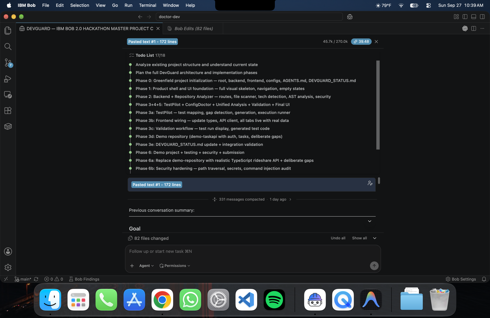</a><br><strong>01 · Project plan and phases</strong></td>
<td width="33%" align="center"><a href="submission/bob-usage/bob-session-02.png">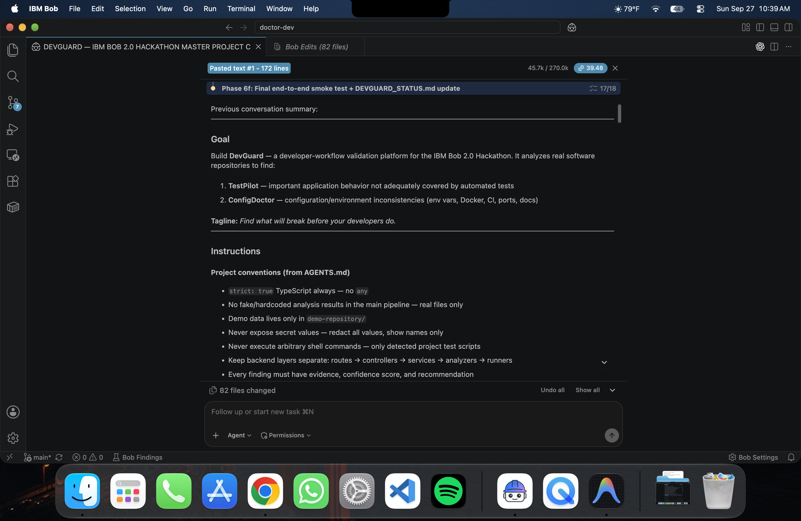</a><br><strong>02 · Goals and engineering rules</strong></td>
<td width="33%" align="center"><a href="submission/bob-usage/bob-session-03.png"></a><br><strong>03 · Stack and workflow review</strong></td>
</tr>
<tr>
<td width="33%" align="center"><a href="submission/bob-usage/bob-session-04.png">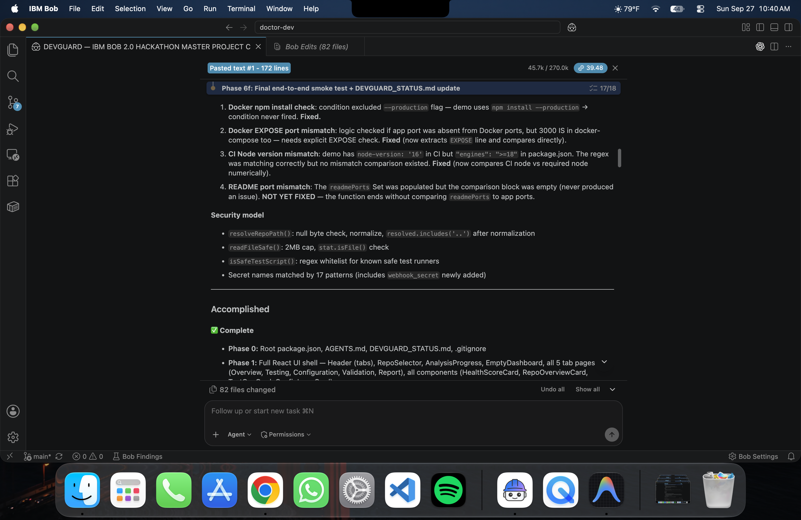</a><br><strong>04 · ConfigDoctor root causes</strong></td>
<td width="33%" align="center"><a href="submission/bob-usage/bob-session-05.png"></a><br><strong>05 · Completed phases</strong></td>
<td width="33%" align="center"><a href="submission/bob-usage/bob-session-06.png">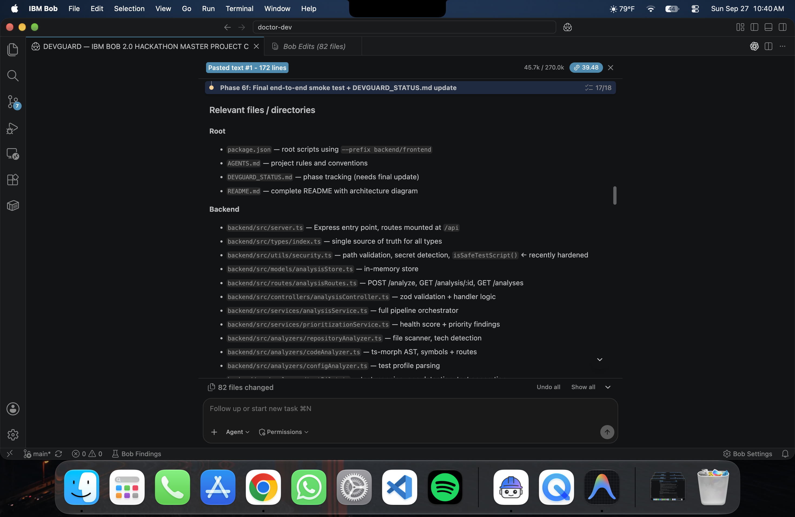</a><br><strong>06 · Backend repository map</strong></td>
</tr>
<tr>
<td width="33%" align="center"><a href="submission/bob-usage/bob-session-07.png">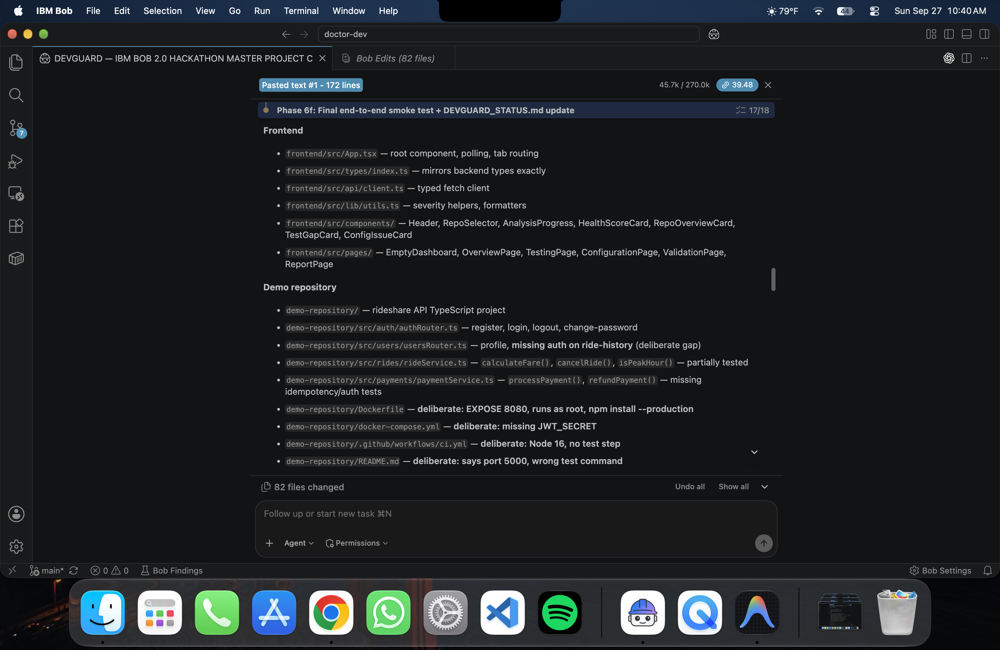</a><br><strong>07 · Frontend and demo review</strong></td>
<td width="33%" align="center"><a href="submission/bob-usage/bob-session-08.png">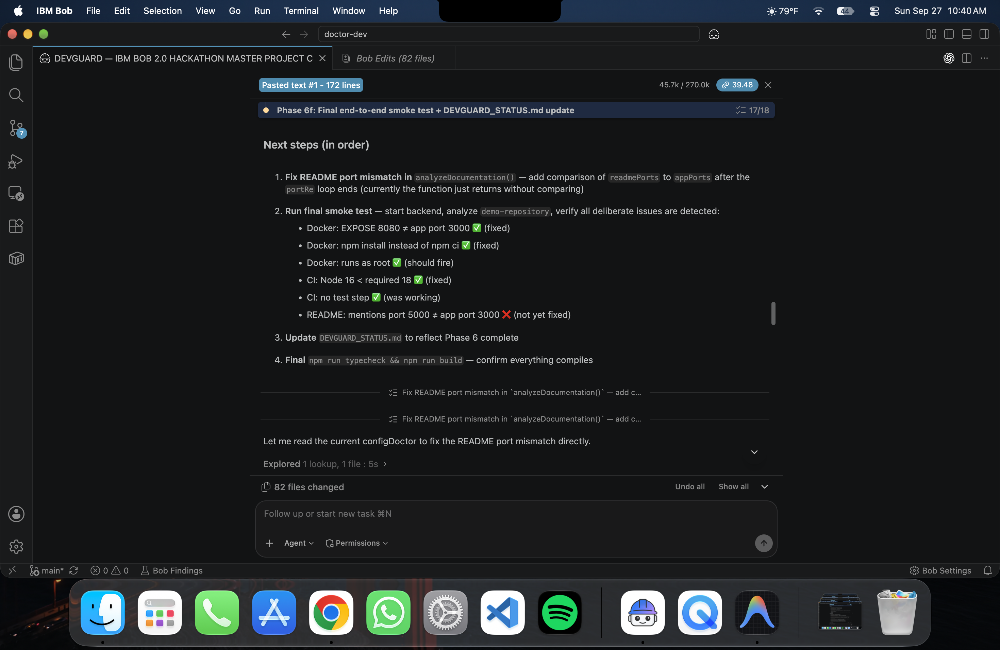</a><br><strong>08 · Final smoke-test plan</strong></td>
<td width="33%" align="center"><a href="submission/bob-usage/bob-session-09.png">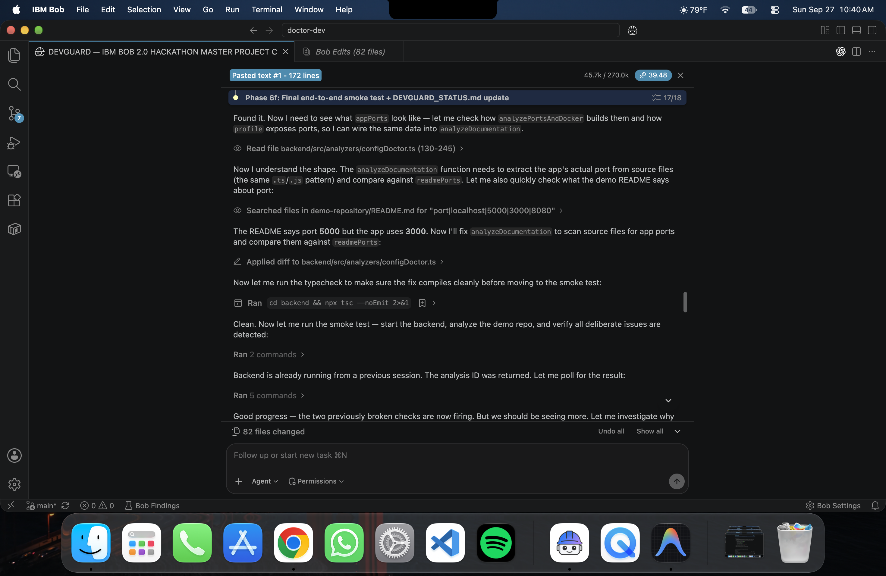</a><br><strong>09 · Port fix and typecheck</strong></td>
</tr>
<tr>
<td width="33%" align="center"><a href="submission/bob-usage/bob-session-10.png">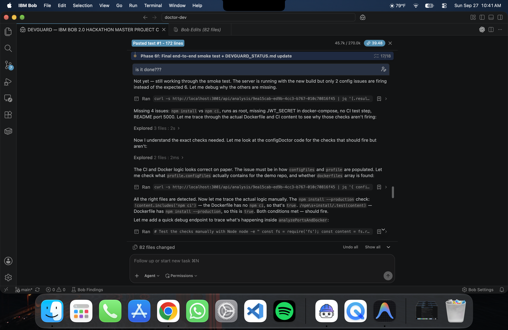</a><br><strong>10 · Smoke-test debugging</strong></td>
<td width="33%" align="center"><a href="submission/bob-usage/bob-session-11.png">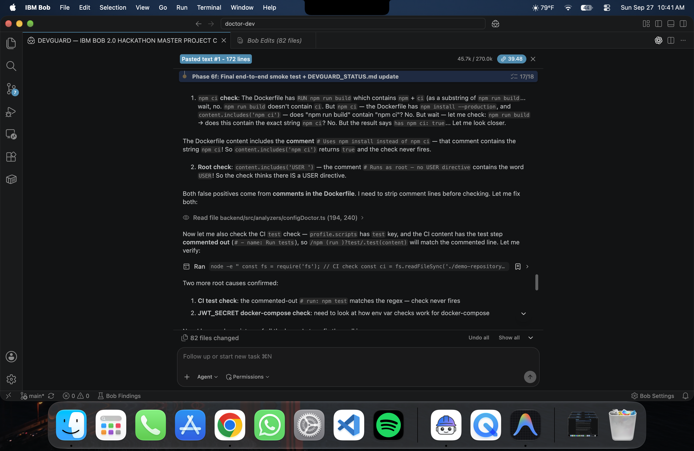</a><br><strong>11 · False-positive diagnosis</strong></td>
<td width="33%" align="center"><a href="submission/bob-usage/bob-session-12.png"></a><br><strong>12 · Targeted analyzer fixes</strong></td>
</tr>
</table>

</details>

Direct evidence: [all Bob screenshots](submission/bob-usage/) · [Bob task JSON export](submission/bob-task-fcbb69e7abf2f34a815ca5d7aa172b92-2026-09-26.json)


## 🗂️ Project structure

```text
doctor-dev/
├── frontend/                 React dashboard
├── backend/                  Express analysis API
├── demo-repository/          Deliberately imperfect rideshare API
├── docs/
│   ├── assets/               Animated README artwork (SVG)
│   ├── architecture.md       Technical architecture
│   ├── benchmark.md          Benchmark notes
│   └── bob-usage.md          IBM Bob development record
├── bob_sessions/             Real IBM Bob evidence store
├── submission/               Hackathon screenshots, Bob evidence, deck, and demo video
├── AGENTS.md                 Engineering conventions
├── DOCTOR_DEV_STATUS.md      Phase tracking
└── README.md                 You are here
```

## 🗺️ Roadmap

- [x] Repository profiling and technology detection
- [x] JavaScript/TypeScript structural analysis
- [x] Python language adapter
- [x] Evidence-based test mapping
- [x] ConfigDoctor cross-file checks
- [x] Health scoring and priority findings
- [x] Public GitHub repository ingestion
- [x] Controlled local test execution
- [x] Markdown and JSON export
- [ ] First-class Java, Go, Rust, C++, C#, PHP, and Ruby adapters
- [ ] Persistent analysis history
- [ ] GitHub App and pull-request annotations
- [ ] Organization policies and baselines
- [ ] SARIF export and CI quality gates

## ⚠️ Current limitations

- Deep analysis is strongest for JavaScript/TypeScript, with an initial Python adapter. Other ecosystems are profiled without equivalent symbol-level analysis.
- Evidence-based coverage is heuristic unless a supported coverage artifact exists.
- Dynamic imports, generated routes, metaprogramming, and custom harnesses can reduce confidence.
- Analysis history is in memory (latest 50) and resets with the backend.
- Public GitHub repositories are supported; private authentication is not implemented.
- Local paths must be inside configured analysis roots.
- Generated tests are starter skeletons and need developer review.

These constraints are visible on purpose: trustworthy tooling distinguishes evidence from inference.

## 🤝 Contributing

Contributions are welcome. Keep changes aligned with [`AGENTS.md`](AGENTS.md):

1. Keep TypeScript strict and avoid `any`.
2. Add a regression test for analyzer behavior.
3. Preserve read-only repository analysis.
4. Never expose secret values.
5. Keep routes thin and logic in services or analyzers.
6. Run all verification commands before opening a pull request.

```bash
git checkout -b feature/your-improvement
npm test && npm run typecheck && npm run build
```

## 📄 License

Doctor Dev is released under the [MIT License](LICENSE).


<div align="center">


### 🩺 Doctor Dev

**Find what will break before your developers do.**

Built with care, repository evidence, strict TypeScript, and IBM Bob 2.0.

Made by **Priyanshu Sharan**

<a href="https://www.linkedin.com/in/priyanshusharan/"></a>

<sub>[⬆ Back to top](#top)</sub>

</div>
